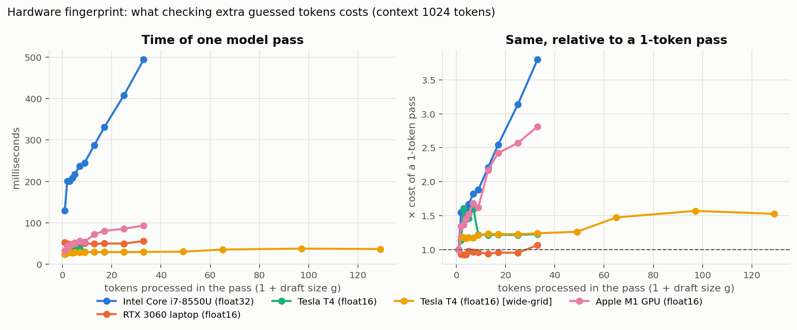
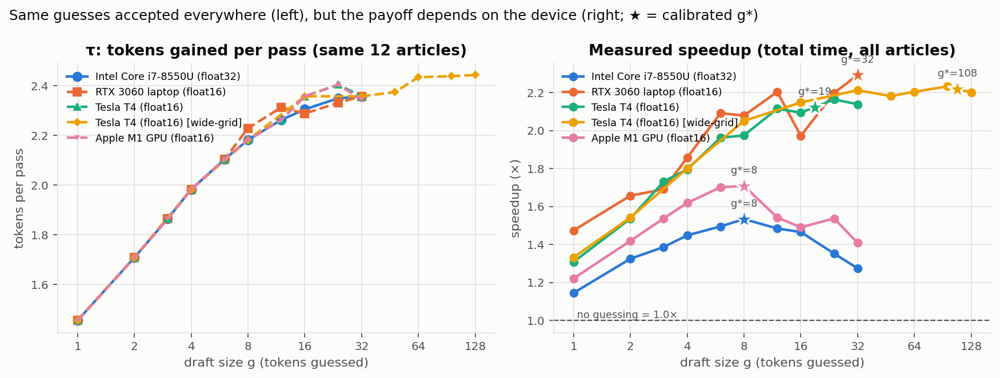
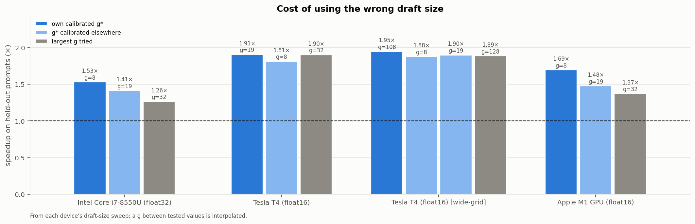
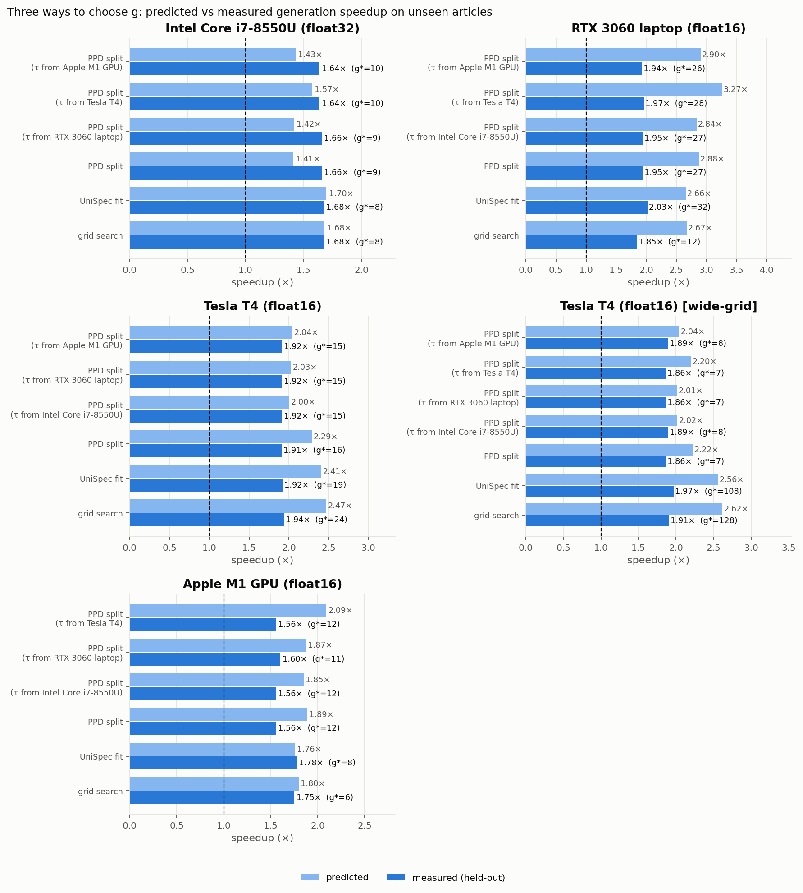
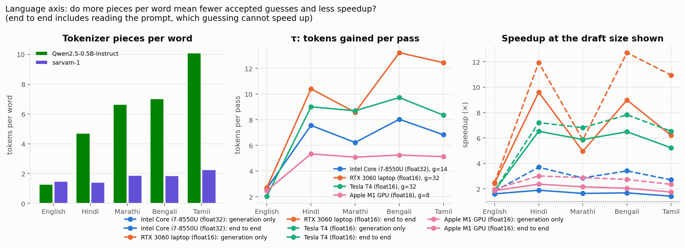
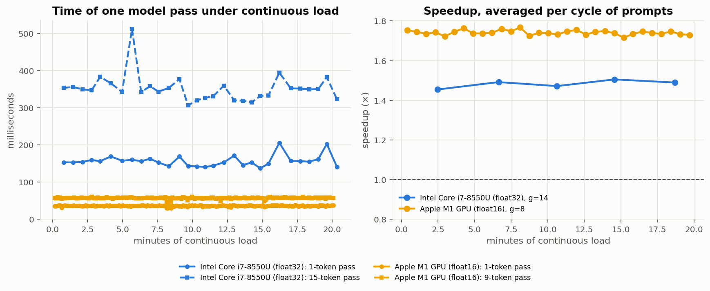
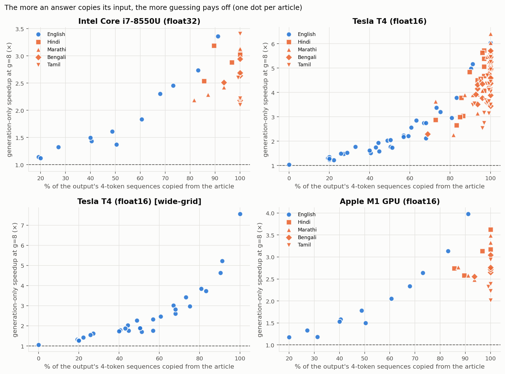

# Training-Free Speculative Decoding on Untested Hardware and Indian Languages

Course project, DA4022 Hardware-Aware Deep Learning — Pranjal Kirar, Aditya Raj, Khushal Nagwal,
Babita Verma, Yash Pratap Singh.

Large language models write text one token at a time, and each token costs one full pass through
the network. **Speculative decoding** guesses several next tokens cheaply and lets the model check all
of them in a single pass, keeping the ones it agrees with. The output is *identical* to normal
decoding; only the speed changes.

How many tokens to guess (the **draft size g**) is a trade-off:

```
speed  =  τ(g) / s(g)
          τ(g): tokens gained per pass   – grows with g, then levels off; the same on every device
          s(g): seconds per pass          – grows with g; how fast depends on the hardware
```

Two recent papers turn this into a **hardware-aware rule**: measure the device, pick the g that
maximises τ/s.

* **UniSpec** (Do et al., ACL 2026) — training-free n-gram drafting with *device-aware calibration*:
  fit regression curves to τ(g) and s(g) on the target device, maximise their ratio with Differential
  Evolution. Evaluated on four high-end NVIDIA GPUs (A100 to RTX 3090) and seven non-Indian languages.
* **PPD** (Chen et al., EMNLP Findings 2025) — *hardware-aware tree pruning* with the same rule,
  splitting it into a hardware-independent part (acceptance, measured once) and a hardware-dependent
  part (forward latency, profiled per device).

Between them the papers name these open gaps: limited compute, unstable hardware, and morphologically rich languages.
This project tests the shared rule there:

| Question | Experiment |
|---|---|
| How differently do a laptop CPU and a GPU charge for checking extra tokens? | `profile` — the *hardware fingerprint* s(n) |
| Is τ(g) really device-independent? | `sweep` on every device, compare τ curves |
| Does UniSpec-style calibration find the best g on cheap hardware? Does PPD's "measure τ once" shortcut? | `calibrate` — grid search vs UniSpec fit vs PPD split, checked on held-out prompts |
| What does a g tuned for another device cost? Can it fall below 1.0×? | `calibrate` + `plots` (cross-device table) |
| Do Hindi, Marathi, Bengali, Tamil behave like English? | `language` — tokens per word, τ, speedup |
| Does calibration survive a laptop heating up or changing power mode? | `thermal`, and any step with `--tag power-saver` |

## Setup used

* Model: `Qwen/Qwen2.5-0.5B-Instruct` (small enough for any laptop CPU; ungated)
* Drafter: n-gram / prompt-lookup (training-free, no extra memory) — the drafter family UniSpec builds on
* Task: summarise a news article (XL-Sum, BBC) — a *grounded* task where the output re-uses input
  phrases. 40 articles per language, cut to 250 words, fixed in `data/xlsum_subset.jsonl`
* Greedy decoding, 128 new tokens, exact token-for-token check against normal decoding
* Precision: fp32 on CPU, fp16 on T4 (chosen automatically per device)

## Results

All figures and tables are regenerated from `results/` by `python run.py plots`;
see **[results/SUMMARY.md](results/SUMMARY.md)** for every number.

| | |
|---|---|
|  |  |
|  |  |
|  |  |
|  | |

### Findings so far (laptop CPU: Intel i7-8550U, fp32 · laptop GPU: Apple M1, fp16 · free GPU: Tesla T4, fp16)

* **Lossless:** 100% identical output on the CPU. On the 16-bit GPUs, 92% (M1) and 100% (T4) in the correctness
  check and 83–100% across the sweeps; the rest diverge at fp16 near-ties between two almost equally likely tokens
  (a rounding effect of half precision, not an error in the method).
* **Hardware fingerprints are opposite:** on the T4 a pass costs ~25 ms for 1 token and ~29–30 ms for
  anything from 2 to 33 tokens — checking guesses is almost free. On the CPU a 2-token pass already
  costs 1.55× a 1-token pass and a 33-token pass 3.8×. The M1's integrated GPU lies in between (2.8×).
* **τ really is device-independent:** on the 12 articles run on all devices, tokens gained per pass
  agree within 0.05 at every g (e.g. 2.18 vs 2.18 at g = 8) — the assumption behind both
  UniSpec's calibration and PPD's "measure acceptance once" split.
* **So the devices respond differently to g:** speedups here are total baseline time over total
  speculative time. The CPU peaks at **1.53× at g = 8** and falls to 1.27× at g = 32, where 4 of 12
  articles were slower than no guessing (0.86–0.98×). The T4 reaches 2.11× at g = 12 and then stays flat
  up to g = 128 (2.20×): a 129-token pass still costs about 1.5× a one-token pass at most, but acceptance
  has saturated. Per-article *averages* would suggest 4.10× at g = 128, but one article copied word for word
  (39.8×) causes that; the median is 2.04×. The M1 behaves like the CPU: **1.71× at g = 8**, 1.41× at g = 32.
* **Cost of the wrong g (held-out articles):** the CPU loses 8% with the T4's calibrated g = 19 and 17% with
  g = 32; the M1 loses 13% and 19%; the T4 loses 4–5% with the laptops' g = 8.
* **Calibration:** on the CPU, UniSpec's fit and grid search both pick g = 8, the best tested size, and the fit
  predicts generation-only speedup closely (1.70× vs 1.68× measured); the PPD split picks 9–10, also with τ
  measured on the T4. On the M1 the fit also picks g = 8, the best tested size (1.76× predicted, 1.78× measured),
  but the PPD split picks 12 and delivers 12% less. On the T4 the curve is flat, so the methods pick anything from 7 to 128 and all deliver
  1.84–1.95× end to end. The fit over-predicts there by 25–30%, because the calibration articles copied
  more (60%) than the held-out ones (43%).
* **Speedup follows copying:** per article, generation-only speedup grows steadily with the share of
  the output copied from the article, on both devices (fig. 7).
* **Languages:** Qwen's tokenizer needs 4.7–10.1 tokens per word for Hindi/Marathi/Bengali/Tamil vs 1.3
  for English. Contrary to our hypothesis, tokens gained per pass are *higher* (the 0.5B model copies
  the article heavily, and each copied word is many tokens). On the T4 this gives **5.2–6.5× end to
  end** (Hindi 6.53×). On the CPU the 3–7× longer prompts take long to read, which guessing cannot speed
  up, so end-to-end gains shrink to 1.41–1.88× although generation alone is 2.7–3.7× faster. The M1 reaches 1.7–2.4× end to end.
* **Sustained load:** over 20 minutes of continuous load the plugged-in laptop got no slower (1.45–1.51× per
  cycle of prompts). It started warm after more than an hour of benchmarks (one-token pass 155 ms against
  130 ms profiled earlier), so this does not rule out throttling. The fanless M1 stayed at 1.74–1.75× for 20 minutes.

## Run it

Python 3.9+.

```bash
pip install -r requirements.txt
python tests/test_engine.py          # engine correctness, no model needed, < 1 s
python run.py all                    # every benchmark on this machine (laptop CPU: ~1.5 h)
python run.py thermal --minutes 20   # optional: sustained-load test (laptops)
python run.py plots                  # figures + results/SUMMARY.md
python report/build_report.py        # report/report.pdf, rebuilt from results/ and figures/
```

* The device (NVIDIA GPU, Apple Silicon GPU, or CPU), its precision and the workload are picked
  automatically. Results go to `results/<device-name>/`.
* Finished steps are skipped on a re-run, so an interrupted run can simply be restarted
  (`--force` redoes them).
* `python run.py all --preset quick` is a few-minute smoke test.
* A different condition on the same machine (e.g. battery saver) gets its own folder:
  `python run.py profile calibrate --tag power-saver` (re-profiles the hardware and re-uses the acceptance numbers already measured; a laptop on battery is detected and labelled `on-battery` automatically).
* Larger draft sizes than the default 32: `python run.py profile sweep calibrate --tag wide-grid --grid 1 2 4 8 16 32 48 64 96 128`.
* **Free T4 GPU:** open `notebooks/colab_t4.ipynb` in Google Colab with a T4 runtime and run all cells.
* For timing quality, keep other heavy programs closed while it runs and keep a laptop plugged in
  (unless that is the condition being measured).

### Adding a new device

Run the commands above on the new machine and copy its `results/<device-name>/` folder into this
repo's `results/`. `python run.py plots` then includes it in every figure. `python scripts/recompute_calibration.py`
then adds the "τ measured on another device" (PPD split) comparison without running any model.

## Report

[report/report.pdf](report/report.pdf) is the project report (LaTeX). It is generated by
`report/build_report.py`, which writes `report/report.tex` and compiles it: every table and most numbers
are computed from `results/`, so after adding a device and running `python run.py plots`,
`python report/build_report.py` rebuilds the report with it.

Compiling needs a LaTeX engine on PATH: [Tectonic](https://tectonic-typesetting.github.io/) (preferred),
`latexmk` or `pdflatex`. Without one, `python report/build_report.py --tex-only` writes the `.tex`, which
compiles on Overleaf when uploaded together with the `figures/` folder.

## Code layout

```
specdec/
  engine.py       lossless draft-and-verify loop (KV-cache invariant), per-pass timing
  drafters.py     n-gram drafter; draft_len = g
  calibrate.py    grid search, UniSpec regression + Differential Evolution, PPD split
  device.py       device / precision detection, hardware description, model loading
  data.py         prompts
  experiments.py  correctness, profile, sweep, calibrate, language, thermal
  plots.py        figures and results/SUMMARY.md
run.py            command-line entry point
scripts/prepare_data.py   rebuilds data/xlsum_subset.jsonl from XL-Sum
tests/test_engine.py      mock-model tests: output must equal greedy decoding
notebooks/colab_t4.ipynb  free-GPU runner
report/                   report generator (build_report.py, report_data.py), report.tex and report.pdf
```

The decoding engine and its tests are adapted from our earlier RetroSpec engine
(`github.com/lxzy8/RetroSpecS`), whose 7-method T4 comparison was reported at the mid-project stage.

## Scope and limitations

* A single chain of guesses, not UniSpec's confidence-scored draft trees; PPD's trained prompt
  tokens are not reproduced (they need GPU training). Both papers are used for their shared
  hardware-aware calibration rule.
* A 0.5B model, smaller than the 1.4–14B models in the papers; its summaries in Indian languages
  are of low quality. Decoding is lossless, so this affects what is generated, not the validity of
  the speed comparison.
* Laptop timings are noisier than server timings; every speedup is a paired, per-prompt ratio
  measured back to back.

## References

* D.-T. Do, N.-K. Le, N. L. Minh. *UniSpec: Training-Free Speculative Decoding for Robust LLM
  Acceleration Across Languages and Hardware.* ACL 2026.
* H. Chen et al. *Hardware-Aware Parallel Prompt Decoding for Memory-Efficient Acceleration of LLM
  Inference.* Findings of EMNLP 2025.
* T. Hasan et al. *XL-Sum: Large-Scale Multilingual Abstractive Summarization for 44 Languages.*
  Findings of ACL 2021. (Data subset used under CC BY-NC-SA 4.0.)
